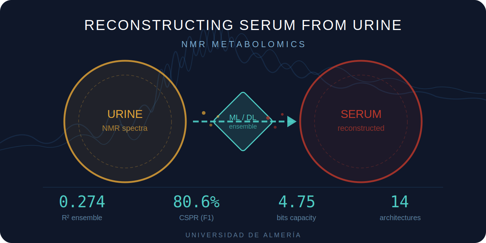

<p align="center">
  
</p>

# Serum metabolome reconstruction from urine NMR data

[](https://opensource.org/licenses/MIT)
[](https://www.python.org/downloads/)
[]()

Code and pre-computed results for:

> Marín-Manzano JD, García-Mañas C, Tristán AI, Abreu AC\*, Arrabal-Campos FM\*, Fernández I\*.
> *Serum metabolome reconstruction reveals transferable systemic metabolic information encoded in urine.*
> Universidad de Almería, Spain. Submitted to *Bioinformatics*.

---

## Overview

Serum ¹H NMR profiles are reconstructed from urinary ¹H NMR profiles with 15 machine learning
architectures and a weighted ensemble, all evaluated by nested cross-validation. The reconstructed
serum is then used to predict COVID-19 status and binarised GGT, creatinine and HDL cholesterol,
and compared with measured serum and with direct prediction from urine. A Shannon
information-theoretic analysis quantifies how much information is transferred between biofluids.

```
Urine NMR ──► [15 models + cross-fitted ensemble, nested CV] ──► reconstructed serum
                                         │
   [same nested classification pipeline for real serum, reconstructed serum and urine]
                                         ▼
     COVID-19, GGT, creatinine, HDL  ──►  CSPR, ITE, channel capacity
```

## Key results (v5, nested protocol)

| Metric | Value |
|--------|-------|
| Weighted ensemble R² (cross-fitted) | 0.272 ± 0.031 |
| Best individual model | TabPFN-3.5, R² = 0.263 ± 0.039 |
| Stable architectures (R² > 0.05) | 9 of 15 (R² = 0.07–0.26) |
| Global information transfer efficiency (ITE) | 0.096 (PC1: 0.198, r = 0.955) |
| Shannon channel capacity | 4.65 bits |
| Mean CSPR, AUC / F1-macro | 76.4% / 75.5% |
| Best F1-macro, real / reconstructed serum / urine — COVID-19 | 0.953 / 0.645 / 0.806 |
| Best F1-macro, real / reconstructed serum / urine — HDL cholesterol | 0.716 / 0.528 / 0.541 |

CSPR is the ratio of reconstructed- to measured-serum performance. Because it is a ratio of raw
metrics, a chance-level classifier still obtains a non-zero CSPR; chance-corrected values are in
`Results_v5/` and in Table S8 of the Supplementary Information.

## What changed in v5 (revision, October 2026)

* **No information leakage in preprocessing.** The PQN reference spectrum and the Shannon
  mutual-information (MI) feature weights are now estimated inside every training partition
  (outer and inner folds). In v4 both were computed once on all 289 samples; the MI weights used
  the serum targets of the test samples.
* **Cross-fitted ensemble and stacking.** Candidate models, ensemble weights and meta-learner
  hyperparameters for each outer test fold are selected using only the other folds, so the
  ensemble R² is a proper nested estimate.
* **One classification protocol for every input.** Real serum, reconstructed serum and urine are
  classified with the same pipeline (median imputation, PQN for urine, StandardScaler, PCA),
  classifiers, hyperparameter grids and partitions, with nested CV (`--protocol nested`, main
  analysis). A fixed-hyperparameter protocol with four PCA components (`--protocol fixed`) is
  reported as a sensitivity analysis.
* **CSPR from the main classification.** CSPR is computed from the same classification results
  as Table 2 (five classifiers), not from a separate set-up.
* **TabPFN-3.5** (package `tabpfn` 9.2) replaces TabPFN-2.5; its point prediction (mean, median or
  mode of the predictive distribution) is tuned in the inner loop.
* Training R², overfitting gap and MAE are reported for all models; the spectral information map
  is plotted against the urine bin index (the bucket tables carry no chemical-shift labels).

The v4 code and results are kept in [`legacy_v4/`](legacy_v4/) for reference.

## Repository structure

```
├── serum_reconstruction_v5.py   # 15 models, nested CV, cross-fitted ensemble/stacking
├── run_v5_groups.sh             # runs groups of models in parallel processes
├── classification_v5.py         # nested and fixed protocols for real/reconstructed serum and urine
├── info_transfer_v5.py          # ITE, MI, channel capacity, CSPR, Figures S1–S4
├── make_figure1_v5.py           # Figure 1 of the manuscript
├── requirements.txt
├── Data/                        # NMR bucket tables (not included, see Data/README.md)
├── Results_v5/
│   ├── models/*.json            # per-model results, fold-level R² and selected hyperparameters
│   ├── results_comparison_v5.xlsx, results_v5.json, ensemble_v5.json
│   ├── predicted_serum_ensemble_full.xlsx   # cross-fitted reconstructed serum (289 × 231)
│   ├── classification/{nested,fixed}/       # summaries, fold-level metrics, CSPR tables
│   ├── info_transfer/{nested,fixed}/        # ITE/MI/SNR/capacity tables
│   └── all_results_v5.json                  # every number used in the manuscript
├── Figures_v5/                  # Figure 1 and Figures S1–S4 for both protocols
└── legacy_v4/                   # previous version (v4) of code and results
```

## Installation

```bash
git clone https://github.com/fmarrabal/reconstructing_serum_urine.git
cd reconstructing_serum_urine
python -m venv .venv && source .venv/bin/activate      # Windows: .venv\Scripts\activate
# PyTorch with CUDA (optional but recommended for TabPFN and the neural networks)
pip install torch --index-url https://download.pytorch.org/whl/cu130
pip install -r requirements.txt
```

### TabPFN-3.5 weights

The TabPFN-3.5 weights are released by Prior Labs under a non-commercial licence (research use is
permitted). On first use, `tabpfn` opens a browser to log in at Prior Labs and accept the licence,
then downloads and caches the weights; afterwards it works offline. In headless environments,
accept the licence at <https://ux.priorlabs.ai> and set the `TABPFN_TOKEN` environment variable.
Never write tokens into the scripts.

## Usage

All scripts are run from the repository root with the data in `Data/`.

```bash
# 1. Serum reconstruction (one or several models per process; outputs go to Results_v5/models)
python serum_reconstruction_v5.py --models BaggingSVR+,BaggingKNN,PLS,Ridge,ElasticNet
python serum_reconstruction_v5.py --models TabPFN --tabpfn-version v3.5
bash run_v5_groups.sh "XGBoost,LightGBM,ExtraTrees" "MLP_Wide" "MLP_Deep" "SAN_MLP" "ResidualMLP" "1D_CNN" "TabNet"
python serum_reconstruction_v5.py --ensemble        # cross-fitted ensemble and stacking

# 2. Classification of real serum, reconstructed serum and urine (both protocols)
python classification_v5.py --protocol both --recon Results_v5/predicted_serum_ensemble_full.xlsx

# 3. Information-transfer analysis and figures
python info_transfer_v5.py --cspr-dir Results_v5/classification/nested \
       --out-dir Results_v5/info_transfer/nested --fig-dir Figures_v5/nested
python make_figure1_v5.py Results_v5/all_results_v5.json Figures_v5/Figure1.png
```

`--smoke` runs the reconstruction with very few trials to test the pipeline end to end. With the
settings of the paper, the reconstruction takes about 3 h on a 16-thread workstation with one GPU
when the model groups are run in parallel.

## Data

The NMR data are not included because they are patient data subject to ethical restrictions. See
[`Data/README.md`](Data/README.md) for the expected files. Access requests should be directed to
the corresponding authors.

## Citation

```bibtex
@article{marin2026serum,
  title   = {Serum metabolome reconstruction reveals transferable systemic metabolic information encoded in urine},
  author  = {Mar{\'\i}n-Manzano, Juan de Dios and Garc{\'\i}a-Ma{\~n}as, Celia and Trist{\'a}n, Ana Isabel and
             Abreu, Ana Cristina and Arrabal-Campos, Francisco Manuel and Fern{\'a}ndez, Ignacio},
  journal = {Bioinformatics},
  year    = {2026},
  note    = {Submitted}
}
```

## License

MIT — see [LICENSE](LICENSE). The TabPFN-3.5 weights are subject to their own non-commercial licence.

## Contact

- Francisco Manuel Arrabal-Campos — [fmarrabal@ual.es](mailto:fmarrabal@ual.es)
- Ignacio Fernández — [ifernan@ual.es](mailto:ifernan@ual.es)
